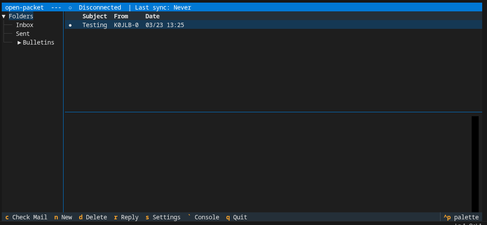

# open-packet

An open-source packet messaging client for amateur radio operators.



---

## Features

- **Personal messages & bulletins** — sync your inbox and bulletins from a BPQ-style BBS node to a local SQLite database
- **Terminal sessions** — connect directly to a node for an interactive keyboard-to-keyboard session
- **Form messages** — fill out and send structured messages from bundled templates: NTS radiogram, ICS forms (ICS-213, ICS-205, etc.), and general forms
- **Search** — search your stored messages and bulletins by subject, body, or callsign
- **Scheduled send/receive** — automatically sync on a configurable interval
- **Desktop notifications** — get notified when new mail arrives
- **Multiple identities** — manage several operators, nodes, and interfaces, with node groups for organizing your connections
- **Flexible connections** — Telnet, KISS over TCP, or KISS over serial
- **Frame console** — inspect raw AX.25 frame traffic, optionally logged to file
- **Terminal & web frontends** — run in your terminal, or serve the UI over the web with `op-web`

The core engine is interface-agnostic — the terminal client is the primary frontend, with the web frontend built on the same engine.

---

## Quickstart

**Requirements:**
- Linux (Windows and macOS are currently untested, but should probably work)
- Python >= 3.11
- A connection to a BBS/node — either:
  - A KISS-capable TNC connected via TCP or serial port (if you don't have hardware, [Direwolf](https://github.com/wb2osz/direwolf) is a good software TNC), or
  - A Telnet-reachable node over the network

**Install:**

```bash
uv tool install git+https://github.com/loredous/open-packet
```

**Run:**

```bash
open-packet
```

On first launch you'll be guided through setting up your operator identity (callsign, SSID), a network interface, and a BBS node. You can add or change any of these later from the Settings screen (`ctrl+s`).

---

## How It Works

open-packet connects to a BBS/node — over AX.25 packet radio via a KISS TNC, or over Telnet — and syncs your personal messages and bulletins to a local SQLite database. Everything you compose, receive, and read is stored locally, so the app is fully usable offline; syncing happens on demand (`ctrl+c`) or on a schedule.

Operator identity, node configuration, and network interfaces are all created and managed interactively through the TUI and stored in the SQLite database — there is no configuration file to edit for these.

---

## Keyboard Shortcuts

| Key | Action |
|-----|--------|
| `ctrl+c` | Send/Receive (sync with node) |
| `ctrl+n` | New… (message, bulletin, or form message) |
| `ctrl+r` | Reply to selected message |
| `ctrl+f` | Search messages |
| `ctrl+a` | Archive selected message |
| `ctrl+x` | Delete selected message |
| `ctrl+u` | Queue bulletin for retrieval |
| `ctrl+t` | Open a terminal session |
| `ctrl+d` | Disconnect active session |
| `ctrl+s` | Settings |
| `` ` `` | Toggle the AX.25 frame console |
| `ctrl+q` | Quit |

---

## Configuration

open-packet does not use a YAML config file. Storage and file paths are set via command-line flags or environment variables; everything else (operators, nodes, interfaces, export path, console options, scheduled sync, notifications) is configured in-app and stored in the database.

**Command-line flags:**

```bash
open-packet \
  --db-path ~/.local/share/open-packet/messages.db \
  --log-path ~/.local/share/open-packet/open-packet.log \
  --console-log ~/.local/share/open-packet/console.log \
  --forms-dir ~/.config/open-packet/forms
```

**Environment variables** (used when the matching flag is omitted):

| Variable | Purpose | Default |
|----------|---------|---------|
| `OPEN_PACKET_DB_PATH` | SQLite message database | `~/.local/share/open-packet/messages.db` |
| `OPEN_PACKET_LOG_PATH` | Application log file | `~/.local/share/open-packet/open-packet.log` |
| `OPEN_PACKET_CONSOLE_LOG` | AX.25 frame console log file | *(disabled)* |
| `OPEN_PACKET_FORMS_DIR` | Directory of form templates | `~/.config/open-packet/forms` |

In-app settings are reached from the Settings screen (`ctrl+s`): **General** (export path, console options, scheduled send/receive, notifications, auto-discovery), **Operator**, **Node**, and **Interfaces**.

---

## Web Frontend

open-packet can serve its UI over the web using [textual-serve](https://github.com/Textualize/textual-serve):

```bash
op-web
```

This launches the same interface in a browser.

---

## Development

```bash
# Clone and install dependencies
git clone https://github.com/loredous/open-packet.git
cd open-packet
uv sync

# Run the app
uv run open-packet

# Run tests
uv run pytest

# Run with Textual's dev tools (live reload + DOM inspector)
# Note: this launches OpenPacketApp directly, bypassing main() — paths load from defaults
uv run textual run --dev open_packet/ui/tui/app.py
```

User-facing documentation lives in `docs/hugo/` as a [Hugo](https://gohugo.io/) site and is published to GitHub Pages on each release. See `CLAUDE.md` for architecture notes and `docs/hugo/` for the full docs.

---

## Contributing

Contributions are welcome.

- Fork the repo and create a feature branch
- Write tests for new functionality
- Run `uv run pytest` before opening a pull request
- Open a pull request with a clear description of the change

---

## License

MIT — see [LICENSE](LICENSE) for details.
